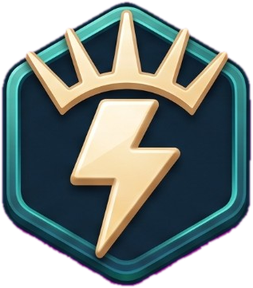
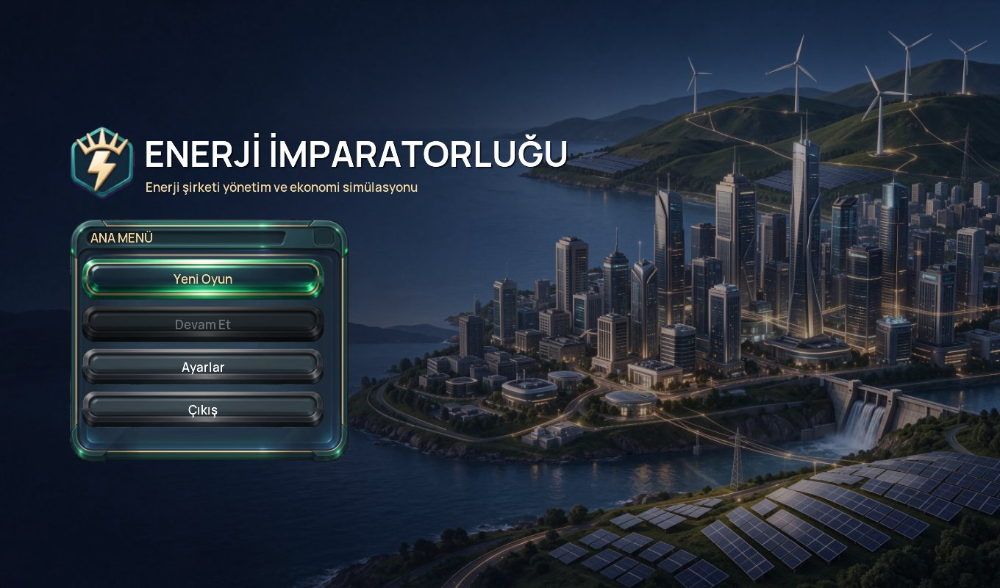
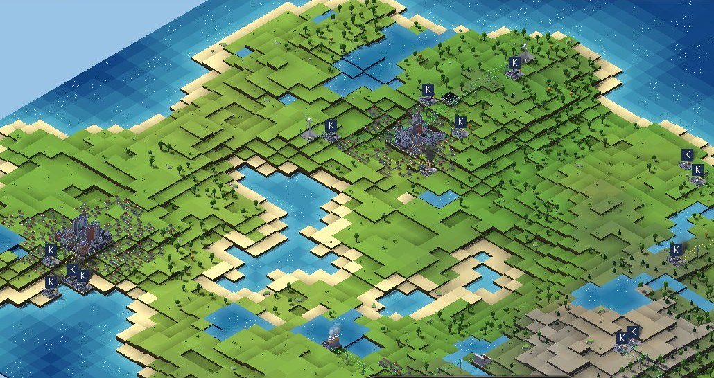
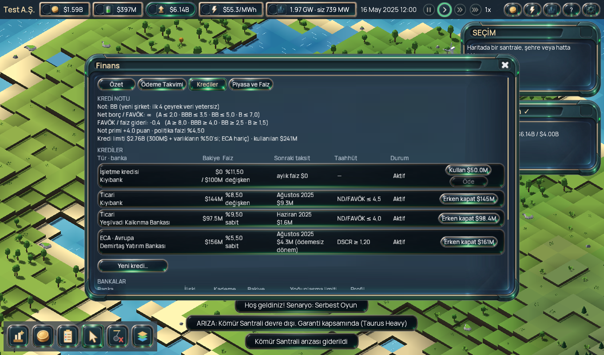
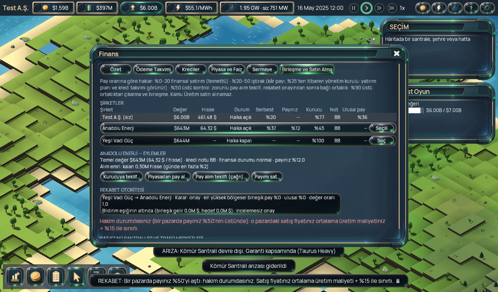

<p align="center">
  
</p>

<h1 align="center">Enerji İmparatorluğu · Energy Empire</h1>

<p align="center">
  <b>An isometric 3D energy company management and economic simulation</b><br>
  Build power plants, grow your grid, compete in the electricity market, finance with debt, go public and take over your rivals.
</p>

<p align="center">
  <a href="README.md">Türkçe</a> · <b>English</b>
</p>

<p align="center">
  
</p>

> The game's interface is in Turkish. This document is an English guide to its systems.

---

## Contents

- [Highlights](#highlights)
- [Installation and running](#installation-and-running)
- [Gameplay](#gameplay)
  - [Electricity market](#electricity-market)
  - [Plants, equipment and suppliers](#plants-equipment-and-suppliers)
  - [Grid: lines, substations, the TSO](#grid-lines-substations-the-tso)
  - [State fleet, tenders and asset sales](#state-fleet-tenders-and-asset-sales)
  - [Finance](#finance)
  - [Equity, share purchases and takeovers](#equity-share-purchases-and-takeovers)
  - [Competition authority](#competition-authority)
  - [Rivals](#rivals)
- [Maps, settings and scenarios](#maps-settings-and-scenarios)
- [Controls](#controls)
- [Development](#development)
- [Project structure](#project-structure)
- [Third-party content and licences](#third-party-content-and-licences)

---

## Highlights

- **Hourly electricity market:** Every hour, demand is met starting with the cheapest plant (merit order). Weather, fuel prices and the carbon tax set the price. When the hourly reserve drops below 10%, a scarcity premium appears even without load shedding.
- **Capacity mechanism:** Every plant is paid monthly for its firm capacity (nuclear 90%, gas 90%, coal 85%, hydro 50%, wind 10%, solar 4%). The unit price follows the reserve margin at the tightest peak hour of the last 12 months: zero when capacity is plentiful, ~$80k/MW-year at the 15% target, higher in scarcity. Coal, nuclear and gas plants earn this on top of energy sales.
- **Realistic grid:** MV / HV / EHV line tiers, plant clusters, substations, line losses, congestion and outages. The transmission system operator (UŞİ) builds lines on application.
- **16 fictional suppliers, 20 equipment models:** Solar, wind, gas, coal, hydro and nuclear. Each model differs in price, efficiency, degradation and build time; new technologies arrive over the years.
- **Deep finance system:**
  - Central bank policy rate, economic regimes and global events.
  - Credit rating (A–CCC) and three banks.
  - Commercial loans, ECA export credit and a revolving credit facility.
  - Automatic instalment collection, late payment, default and one-time restructuring.
- **Capital markets:** IPO, rights issues, buybacks, dividends and a daily share price.
- **Mergers and acquisitions:** Negotiation with founders, market purchases, tender offers, takeover defence, mandatory offers, subsidiaries and full mergers. You manage subsidiaries' assets as your own and can move cash between group companies.
- **Competition authority:** Market-share-based merger control, divestment commitments, a dominant-position price cap and a regulated-monopoly mode.
- **Fair rivals:** AI rivals play by exactly the same rules as the player. They take each other over, and they can take you over too.
- **6 map types, 6 scenarios**, 3 difficulty levels. Real-time shadows, a day–night cycle and growing cities.
- **Portable:** No installation. The game writes only inside its own folder.

<p align="center">
  
</p>

---

## Installation and running

### Windows (ready-made package)

The portable Windows package (`EnerjiImparatorlugu-…-Windows.zip`) ships with a bundled Java runtime; **you do not need to install Java**.

1. Extract the zip into a folder you can write to (Desktop, Documents or a USB stick; not *Program Files*).
2. Double-click **`Baslat.bat`** ("Start").
3. If the game does not open, run **`Hata-Ayiklama.bat`** ("Debug"). The error is shown on screen and written to `veri\hata.log`.

> If Windows SmartScreen warns about an unrecognised app, choose **More info → Run anyway**.

### JAR (Windows, Linux, macOS)

Requirement: **Java 17 or later** (a JRE is enough).

```bash
./gradlew fatJar
java -jar build/libs/energytycoon.jar
```

The JAR bundles the native OpenGL libraries for Windows, Linux and macOS (Intel and Apple Silicon). Ready-made distributions include `run.bat` (Windows) and `./run.sh` (Linux/macOS) scripts that launch `dist/EnerjiImparatorlugu.jar`.

### Saves and settings

The game is **portable** and writes only to the `veri/` ("data") sub-folder next to it:

| Folder | Contents |
|---|---|
| `veri/kayitlar/` | Saves (F5 / F9) and an automatic save at the start of each year |
| `veri/ayarlar/` | Graphics and game settings |
| `veri/kutuphaneler/`, `veri/gecici/` | Graphics libraries |
| `veri/hata.log` | Error log |

To uninstall, delete the folder.

---

## Gameplay

### Electricity market

- Every hour, cities' demand is met by plants ordered from the cheapest bid to the most expensive. The price is the cost of the last plant dispatched.
- If supply falls short, the price jumps to the scarcity level and unserved demand is fined.
- Demand follows daily and seasonal cycles. Wind and cloud cover change hourly.
- Fuel prices fluctuate (including gas supply shocks). The carbon tax rises every year.
- When grid islands connect, their markets merge.

### Plants, equipment and suppliers

Choosing a plant type opens a model selection window. Each model sets output, efficiency and emissions, annual degradation, price and build time. A supplier's reputation affects outage frequency and the risk of delivery delays. Repairs are free during the warranty period. Supplier price indices fluctuate monthly.

| Type | Models |
|---|---|
| Solar | SunPeak PERC (cheap, ages fast) · Helion TOPCon · Lumina bifacial HJT (low heat loss) · Kuzey Güneş tandem (next generation) |
| Wind | Rüzgarsan IEC-I (strong wind, domestic) · Aeolus balanced · Nordwind low wind (large rotor) · Boreal 7.2 MW (2028) |
| Gas | Atlas open cycle (peaker) · Atlas combined cycle · Meridian H-class (highest efficiency) |
| Coal | Ferrum subcritical / supercritical · Taurus ultra-supercritical |
| Hydro | Hydrova Kaplan (low head) · Hydrova Francis · Alpina Pelton (mountain lake) |
| Nuclear | Atomtek Gen III+ · Polaris small modular reactor (2030) |

Suppliers have real countries of origin: Germany, Denmark, Spain, Italy, France, Norway, Switzerland, the USA, Canada, Japan and China. The country sets the insurance premium of ECA export credit. Domestic suppliers have no ECA.

Built plants can be **upgraded**:

| Plant | Upgrades |
|---|---|
| Solar | Single-axis tracker, robotic panel cleaning |
| Wind | Repowering |
| Coal | Carbon capture (CCS), biomass co-firing |
| Gas | Carbon capture (CCS), hydrogen blending |
| Hydro | Turbine retrofit |
| Nuclear | Life extension |

### Grid: lines, substations, the TSO

- **Line tiers:** MV 34.5 kV (OG), HV 154 kV (YG) and EHV 380 kV (ÇYG). Longer lines lose more power. A plant with no line cannot sell electricity.
- **Clusters:** Your adjacent plants form a single connection point and share its line.
- **Substations (TM):**
  - A substation collects the plants within its radius; its export is limited by transformer capacity and lines.
  - Rivals pay a per-MWh access fee to use a substation you open to third parties; you pay when you connect to someone else's.
- **The TSO (UŞİ):** You can build your own line or apply to the TSO. The TSO connects you through an application queue, slower but with no capital outlay, in exchange for an annual connection charge.
- **Upgrades and outages:** Congested lines are expanded with parallel lines or tier upgrades. Lines can fail.

### State fleet, tenders and asset sales

- **State generator (Kamu Üretim):** Old state-owned plants, marked with a "K" badge on the map. It is not a rival and retires its fleet on a schedule through the 2030s.
- **Emergency capacity tender:** If a city receives less than 60% of its demand for 12 consecutive months, the TSO opens a tender. The lowest 10-year price bid wins. If the winner fails to build within 24 months, it forfeits its deposit.
- **Asset sales:** You can list a plant or substation for 30 days. If no company buys it, the state buys the plant (if it wants it) and the TSO buys the substation at a floor price.
- **Bankruptcy:** A bankrupt company's assets are not demolished; they pass to the state and the TSO.

### Finance

<p align="center">
  
</p>

The Finance window (**F** key, or click the cash indicator) has six tabs: **Summary · Payment Schedule · Loans · Market and Rates · Equity · Mergers and Acquisitions**.

- **Macro environment:**
  - The central bank meets every two months.
  - It moves between easing, neutral and tightening regimes.
  - Global events — financial crisis, inflation, energy shock, country risk and a green wave — affect credit spreads.
  - The market forecasts the 12-month rate path with roughly 70% accuracy.
- **Credit rating (A–CCC):** Calculated quarterly from net debt / EBITDA and EBITDA / interest. Subsidiaries are consolidated. The rating sets your spread and whether banks will lend to you.
- **Banks:**

  | Bank | Profile |
  |---|---|
  | **Deutsche Bunk** | General commercial bank; the widest limit |
  | **Crédit Agricool** | Renewables-focused: discount and up to 10-year tenor for renewable loans; does not lend to fossil plants |
  | **Lemon Brothers** | High risk appetite: lends even to CCC; 0.5 pp cheaper on acquisition loans |

  Your relationship score with each bank rises with instalments paid on time and gradually unlocks fee discounts and lower spreads.
- **Loan products:**
  - **Commercial loan:** 3–7 years (10 years at Crédit Agricool); fixed or floating; monthly or quarterly instalments.
  - **ECA export credit:** 85% of the equipment price; with a grace period and a lower rate. Chosen in the equipment window when ordering a plant. The plant's debt service coverage ratio (DSCR) is monitored.
  - **Revolving credit facility:** Drawn automatically when cash goes negative.
  - **Acquisition loan:** For mergers and acquisitions.
- **Collection and default:**
  - Instalments are deducted from cash automatically on the due date.
  - If cash falls short, the revolver is used. If that is exhausted too, a 30-day grace period applies and default begins at 90 days.
  - The banks offer a restructuring once per game.
  - The Payment Schedule tab shows the next 12 months of instalments and any projected cash gap.

### Equity, share purchases and takeovers

<p align="center">
  
</p>

- **Valuation:** Fundamental value is book equity plus a P/E multiple × normalised profit. The multiple depends on the policy rate (it rises as rates fall). The credit rating and growth move the multiple by up to ±20%.
- **Share price:** A listed company's price is set daily. It reacts to market sentiment, to quarterly results versus expectations and to news.
- **IPO:**
  - Requirements: at least 8 quarters of operation, a positive total net profit over the last 4 quarters and a credit rating of at least BB.
  - After a 6-month preparation, 15–49% new shares are offered; the player chooses the size.
  - If a crisis breaks out during preparation, the IPO can be postponed or cancelled.
- **Capital operations of a listed company:** Rights issues (once a year), buybacks and a dividend policy (0% / 30% / 50%).
- **Control threshold:** If your founder stake falls below 50%, your company becomes open to hostile takeover. If you are taken over, the game ends.
- **Share purchases:**
  - You can approach a founder with an offer. The flow is offer → counter-offer → final decision, with the reason for refusal or acceptance shown.
  - You can buy shares of a listed company on the market. Specific thresholds from 5% to 67% are publicly disclosed.
- **Tender offer:**
  - Only possible for a company whose founder stake is below 50%.
  - The offer must be at least 20% above the market price and stays open for 30 days.
  - The target can defend with buybacks, a dividend increase or a white-knight invitation.
- **Control and merger:**
  - Crossing 50% triggers a mandatory offer to the remaining shareholders, and the deal goes to the competition authority.
  - After approval the company becomes your subsidiary. You manage its assets as your own.
  - You can move cash between the companies through intra-group loans or pay a special dividend.
  - Above 90%, the remaining shares are bought out and the companies merge.
- **Financing:** Cash, an acquisition loan or a share swap.
  - The acquisition loan rate is the commercial rate + 1 pp; the amount can be at most 50% of the target's value.
  - It repays 5% of principal per year, with the remainder due as a balloon at the end of year 7.

### Competition authority

- **Measure:** The relevant market is a connected grid island. Market share is the last 12 months of generation; subsidiaries are included.
- **Merger control:**

  | Situation | Outcome |
  |---|---|
  | Combined regional share ≤ 60% | Approved in a 30-day preliminary review |
  | Combined regional share > 60% | 4-month in-depth review; conditional approval with a commitment to sell plants within 12 months |
  | National share after the deal > 80% | Rejected; no exceptions |

  If the acquirer is worth at least 1.5× the target, a scale exemption applies. If the target is in default, the failing-firm defence raises the regional threshold to 75%. A **competition preview** is shown before every deal.
- **Dominant position:** A company with more than 50% of a market has its selling price capped at its average production cost in that market + 15%.
- **Regulated monopoly:** A company that organically exceeds 80% of national generation enters public-utility mode. Its profit is capped at an 8% return on assets.

### Rivals

0–7 AI rivals (up to 5 on a 64 map, up to 7 on 96 and 128 maps) follow **exactly the same rules** as the player: the same loans, ECA, IPOs, takeovers and competition rules. Rivals are boundedly rational: they never make an investment with a negative value by their own expectations. But their carbon-price expectation, learning speed, risk appetite and attachment to their origin (fossil, green, balanced) are drawn anew every game: one fossil-origin rival takes carbon seriously too late and struggles, another transforms early. Strategic surprises — management changes, growth pushes, cautious phases, technology bets — happen from time to time, so no two games play the same. Technology and equipment model are chosen by net present value from their own carbon-price expectation, market price, supply-demand outlook (including plants under construction), site quality and the company's own cost of capital, and they learn from the actual results of plants in the market. They announce changes of direction, sell or close plants that would lose cash over their remaining life and hold back new builds while heavily indebted. The Companies window shows each rival's current strategy. They build plants, invest in substations and lines, bid in tenders and sell assets when in distress. They can try to take each other over — and you.

---

## Maps, settings and scenarios

**Map types:** Continent · Island · Archipelago · Highlands (lakes, rivers) · River Valley · Desert Coast (strong sun, little water).

**Settings:** Map size (64 / 96 / 128), number of cities (up to 8 / 12 / 16), number of rivals (0–5 / 0–7), difficulty (Easy / Normal / Hard) and map seed. The new-game screen shows a live preview.

| Scenario | Deadline | Goal |
|---|---|---|
| **Free Play** (Serbest Oyun) | None | Reach a market value of $7 billion |
| **Green Transition** (Yeşil Dönüşüm) | 2040 | 60% of your generation renewable, a 25% market share, 95% of demand served. The carbon tax rises twice as fast |
| **Coal Exit** (Kömürden Çıkış) | 2040 | Shut down your old coal fleet while keeping a 30% market share and 95% supply security |
| **Energy Crisis** (Enerji Krizi) | 2030 | Gas is permanently twice as expensive; reach $5.5 billion without going bankrupt |
| **Island Grid** (Ada Şebekesi) | 2033 | Imported fuel costs 80% more on the archipelago; serve 97% of demand and reach $3.5 billion |
| **Consolidation** (Konsolidasyon) | 2040 | A lenient competition authority; reach 80% of national generation through acquisitions and growth (milestones: 35% by 2030, 60% by 2035) |

Goals are tracked in the panel at the bottom right. If the deadline passes, the game ends.

---

## Controls

| Input | Action |
|---|---|
| Left click | Select / place / draw a line |
| Right-drag, WASD / arrow keys | Pan the camera |
| Right click (without dragging), Esc | Cancel the tool / menu |
| Mouse wheel | Zoom |
| Q / E | Rotate the camera 90° |
| Space · 1 / 2 / 3 | Pause · speed |
| B | Investment menu |
| V | My assets |
| F / M / C / H | Finance · Market · Companies · Help |
| Tab | Line tier (MV / HV / EHV) |
| L | Map layer (wind, sun, coal, gas, water): tiles shade from grey to vivid by expected efficiency, with a legend showing the scale |
| Delete | Demolish tool |
| F5 / F9 | Save / load |

The scenario box at the top right has two tabs: **Goals** (scenario objectives and progress) and **Notifications** (the last 80 notifications with dates, newest first; ones with an action are clickable). If you miss the transient notifications at the bottom while playing fast, follow them here; while the tab is closed it shows the unread count.

---

## Development

Requirement: JDK 17+. The Gradle wrapper is included.

```bash
./gradlew test       # unit and simulation tests (run under a Turkish locale)
./gradlew fatJar     # build/libs/energytycoon.jar
./gradlew run        # run directly
```

- Tests run under a Turkish locale (`tr_TR`) to catch bugs specific to Turkish Windows. `LocaleSafetyTest` checks that no locale-dependent case conversion remains in the source.
- **Balance measurements** (headless, long simulations):

  ```bash
  ./gradlew balanceCheck --args="--mode finance --seeds 3"   # rate path, ratings, defaults and bankruptcies
  ./gradlew balanceCheck --args="--mode mna --seeds 10"      # IPOs, takeovers, competition decisions
  ```

  Other modes: `decade`, `shares`, `valuation`, `leverage`. Measurement output lives under `docs/`.
- **Verification hook (`DevHook`):** Takes a screenshot and exits, driven by environment variables; it has no effect in normal play.
  - Example: `ET_SHOT=shot.png ET_SCENARIO=game ET_OPEN=fin_MNA java -jar …`
  - `ET_CLIPSCAN=1` scans every window for clipped text.
  - `ET_CLICKS="Ada|Oyunu"` clicks buttons on the setup screen.

## Project structure

```
src/main/java/com/energytycoon/
├── sim/     Simulation core (independent of LibGDX)
│            GameState (hourly tick), Markets, Finance, Macro, Capital, Mna, Competition,
│            RivalAI, GridOperator, TenderBook, SaleBook, EquipmentCatalog, Scenarios,
│            Balance / GridBalance / FinanceBalance (tuning constants), SaveData (JSON saves)
├── world/   Map generation (MapPreset, WorldMap, rivers)
├── render/  Isometric camera, terrain, shadows, procedural and Kenney models
├── ui/      Scene2D interface: HUD, finance centre, My Assets, windows, charts
└── GameScreen, MenuScreen, DevHook, Main
```

Simulation logic lives only in the `sim` package; the UI and renderer only read from it. All randomness comes from the game's seeded random number generator. The same seed produces the same game.

---

## Third-party content and licences

- **Kenney** 3D Road Tiles — [kenney.nl](https://kenney.nl), CC0. City streets, ring roads, intercity roads and bridge decks. Licence: `src/main/resources/models/roads/License.txt`.
- **Stylized nature pack** (OBJ models and textures supplied by the project owner) — trees, pines, twisted and dead trees, bushes, ferns, flowers, grass, mushrooms, rocks. Simplified by `tools/nature/convert_nature.py` into `src/main/resources/models/nature2/` (leaves in one alpha-cut texture atlas).
- **Kenney** City Kit Commercial 2.1, City Kit Industrial 2.0 and Nature Kit — [kenney.nl](https://kenney.nl), CC0. City and plant buildings, chimneys, cooling towers, tanks, trees, rocks. Licence files: `src/main/resources/models/kenney/*/License.txt`, `assets-src/nature/`.
- **Innerscene Low-poly Nature** tiles — [innerscene.com](https://innerscene.com), CC0. Grass and water palette, water surface.
- **Font:** Manrope V5 by Mikhail Sharanda (free for personal and commercial use and embedding; `src/main/resources/fonts/ManropeV5-LICENSE.txt`). DejaVu Sans for fallback symbols (`src/main/resources/fonts/DejaVu-LICENSE.txt`).
- **Interface art, logos and icons** (main-menu background, panel frames, buttons, supplier, bank and institution emblems): packs provided by the project owner; `src/main/resources/ui/`.
- **LibGDX / LWJGL3** (Apache 2.0), FreeType.
- Bundled Java in the Windows package: **Eclipse Temurin 21 JRE** (GPLv2 + Classpath Exception); its licences are in the package's `jre/legal` folder.

Supplier, bank and company names are fictional. The banks are parodies of real banks.
