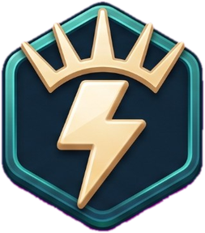
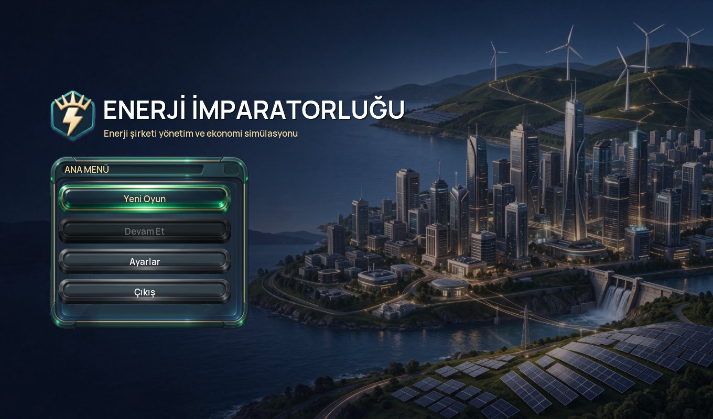
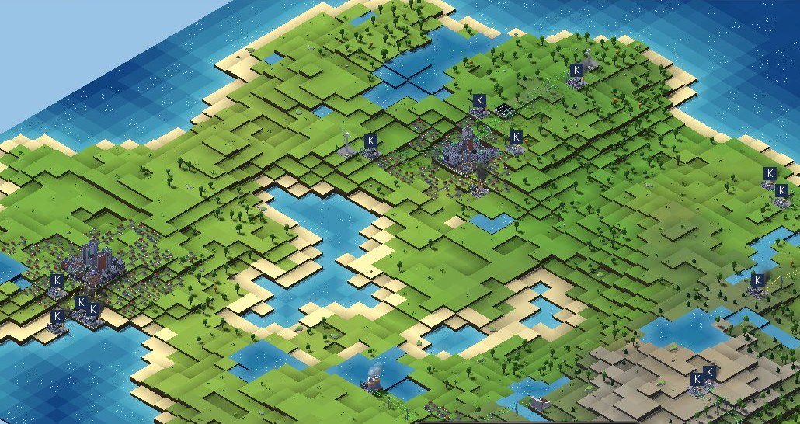
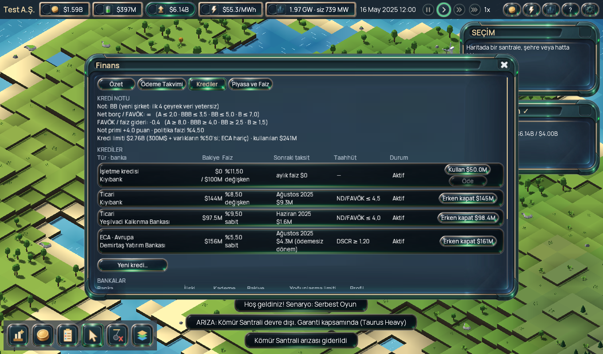
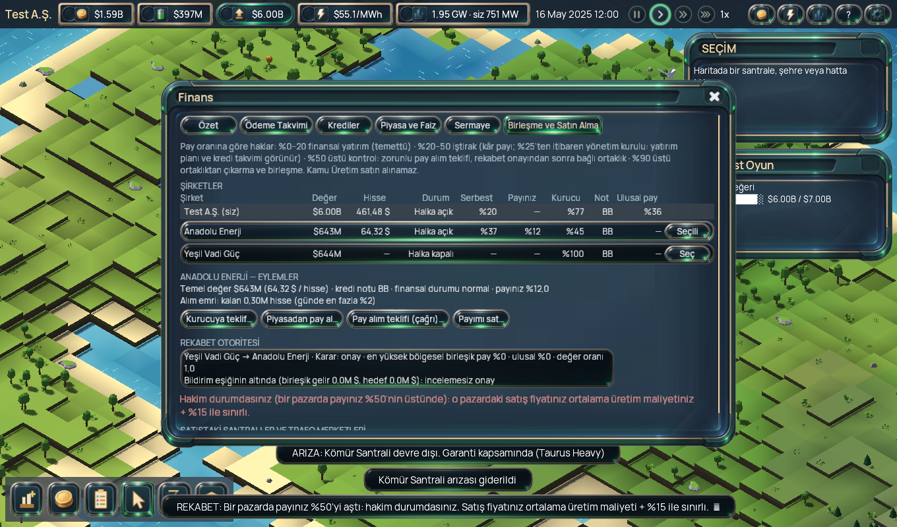

<p align="center">
  
</p>

<h1 align="center">Enerji İmparatorluğu</h1>

<p align="center">
  <b>İzometrik 3D enerji şirketi yönetim ve ekonomi simülasyonu</b><br>
  Santral kur, şebekeni büyüt, elektrik piyasasında rekabet et, krediyle finanse et, halka aç, rakiplerini satın al.
</p>

<p align="center">
  <b>Türkçe</b> · <a href="README.en.md">English</a>
</p>

<p align="center">
  
</p>

---

## İçindekiler

- [Öne çıkanlar](#öne-çıkanlar)
- [Kurulum ve çalıştırma](#kurulum-ve-çalıştırma)
- [Oynanış](#oynanış)
  - [Elektrik piyasası](#elektrik-piyasası)
  - [Santraller, ekipman ve tedarikçiler](#santraller-ekipman-ve-tedarikçiler)
  - [Şebeke: hatlar, trafo merkezleri, UŞİ](#sebeke)
  - [Kamu, ihaleler ve varlık satışları](#kamu-ihaleler-ve-varlık-satışları)
  - [Finans](#finans)
  - [Sermaye, pay alımı ve devralma](#sermaye-pay-alımı-ve-devralma)
  - [Rekabet otoritesi](#rekabet-otoritesi)
  - [Rakipler](#rakipler)
- [Haritalar, ayarlar ve senaryolar](#haritalar-ayarlar-ve-senaryolar)
- [Kontroller](#kontroller)
- [Geliştirme](#geliştirme)
- [Proje yapısı](#proje-yapısı)
- [Üçüncü taraf içerik ve lisanslar](#üçüncü-taraf-içerik-ve-lisanslar)

---

## Öne çıkanlar

- **Saatlik elektrik piyasası:** Talep her saat en ucuz santralden başlayarak karşılanır (merit order). Hava, yakıt fiyatları ve karbon vergisi fiyatı belirler.
- **Gerçekçi şebeke:** OG / YG / ÇYG hat kademeleri, kümeler, trafo merkezleri, hat kayıpları, doluluk ve arızalar. İletim sistemi işletmecisi (UŞİ) başvuruyla hat kurar.
- **16 kurgusal tedarikçi, 20 ekipman modeli:** Güneş, rüzgar, doğalgaz, kömür, hidro ve nükleer. Her modelin fiyatı, verimi, yaşlanması ve inşaat süresi farklı; teknolojiler yıllar içinde piyasaya çıkar.
- **Derin finans sistemi:**
  - Merkez bankası faizi, ekonomik rejimler ve küresel olaylar.
  - Kredi notu (A–CCC) ve üç banka.
  - Ticari kredi, ECA ihracat kredisi ve işletme kredisi.
  - Otomatik taksit tahsilatı, gecikme, temerrüt ve yeniden yapılandırma.
- **Sermaye piyasası:** Halka arz, bedelli sermaye artırımı, geri alım, temettü ve günlük hisse fiyatı.
- **Birleşme ve satın alma:** Kurucuyla pazarlık, piyasadan pay toplama, pay alım teklifi (çağrı), savunma, zorunlu teklif, bağlı ortaklıklar ve birleşme. Bağlı ortaklıkları kendi varlığınız gibi yönetirsiniz ve aralarında para aktarabilirsiniz.
- **Rekabet otoritesi:** Pazar payına dayalı birleşme kontrolü, satış taahhütleri, hakim durum fiyat tavanı ve düzenlenmiş tekel.
- **Adil rakipler:** Yapay zekâ rakipler oyuncuyla tamamen aynı kurallara tabidir. Rakipler de devralma yapar; siz de devralınabilirsiniz.
- **6 harita tipi, 6 senaryo**, 3 zorluk seviyesi. Gerçek zamanlı gölgeler, gün-gece döngüsü ve gelişen şehirler.
- **Taşınabilir:** Kurulum gerektirmez. Oyun yalnızca kendi klasörüne yazar.

<p align="center">
  
</p>

---

## Kurulum ve çalıştırma

### Windows (hazır paket)

Windows taşınabilir paketi (`EnerjiImparatorlugu-…-Windows.zip`) gömülü Java ile gelir; **Java kurmanız gerekmez**.

1. Zip dosyasını yazma izniniz olan bir klasöre açın (Masaüstü, Belgeler veya USB bellek; *Program Files* değil).
2. **`Baslat.bat`** dosyasına çift tıklayın.
3. Oyun açılmazsa **`Hata-Ayiklama.bat`** dosyasını çalıştırın. Hata mesajı ekranda görünür ve `veri\hata.log` dosyasına yazılır.

> Windows SmartScreen "tanınmayan uygulama" uyarısı verirse **Ek bilgi → Yine de çalıştır** seçin.

### JAR (Windows, Linux, macOS)

Gereksinim: **Java 17 veya üzeri** (JRE yeterli).

```bash
./gradlew fatJar
java -jar build/libs/energytycoon.jar
```

JAR; Windows, Linux ve macOS (Intel ve Apple Silicon) için gerekli OpenGL yerel kütüphanelerini içinde taşır. Hazır dağıtımlarda `run.bat` (Windows) ve `./run.sh` (Linux/macOS) betikleri `dist/EnerjiImparatorlugu.jar` dosyasını başlatır.

### Kayıtlar ve ayarlar

Oyun **taşınabilir** çalışır ve yalnızca kendi klasöründeki `veri/` alt klasörüne yazar:

| Klasör | İçerik |
|---|---|
| `veri/kayitlar/` | Kayıtlar (F5 / F9) ve her yıl başında otomatik kayıt |
| `veri/ayarlar/` | Grafik ve oyun ayarları |
| `veri/kutuphaneler/`, `veri/gecici/` | Grafik kütüphaneleri |
| `veri/hata.log` | Hata kaydı |

Oyunu kaldırmak için klasörü silmeniz yeterlidir.

---

## Oynanış

### Elektrik piyasası

- Her saat şehirlerin talebi, teklifleri en ucuzdan pahalıya sıralanan santrallerle karşılanır. Fiyat, devreye giren son santralin maliyetidir.
- Arz yetmezse fiyat kıtlık seviyesine sıçrar ve karşılanamayan talep için ceza kesilir.
- Talep günlük ve mevsimsel döngüyle değişir. Rüzgar ve bulutluluk saatlik değişir.
- Yakıt fiyatları dalgalanır (gaz arz şokları dahil). Karbon vergisi her yıl artar.
- Şebeke parçaları birleşince piyasalar da birleşir.

### Santraller, ekipman ve tedarikçiler

Bir santral türü seçildiğinde model seçim penceresi açılır. Her model üretimi, verimi ve emisyonu, yıllık yaşlanmayı, fiyatı ve inşaat süresini belirler. Tedarikçinin itibarı arıza sıklığını ve teslim gecikmesi riskini etkiler. Garanti süresi boyunca onarım ücretsizdir. Tedarikçi fiyat endeksleri aylık dalgalanır.

| Tür | Modeller |
|---|---|
| Güneş | SunPeak PERC (ucuz, hızlı yaşlanır) · Helion TOPCon · Lumina çift yüzlü HJT (sıcakta az kayıp) · Kuzey Güneş tandem (yeni nesil) |
| Rüzgar | Rüzgarsan IEC-I (güçlü rüzgar, yerli) · Aeolus dengeli · Nordwind düşük rüzgar (büyük rotor) · Boreal 7,2 MW (2028) |
| Doğalgaz | Atlas açık çevrim (puant) · Atlas kombine çevrim · Meridian H-sınıfı (en yüksek verim) |
| Kömür | Ferrum subkritik / süperkritik · Taurus ultra-süperkritik |
| Hidro | Hydrova Kaplan (alçak düşü) · Hydrova Francis · Alpina Pelton (dağ gölü) |
| Nükleer | Atomtek Gen III+ · Polaris küçük modüler reaktör (2030) |

Tedarikçilerin gerçek üretim ülkeleri vardır: Almanya, Danimarka, İspanya, İtalya, Fransa, Norveç, İsviçre, ABD, Kanada, Japonya ve Çin. Bu ülkeler ECA ihracat kredisinin sigorta primini belirler. Yerli tedarikçilerde ECA yoktur.

Kurulu santrallere **yükseltme** yapılabilir:

| Santral | Yükseltmeler |
|---|---|
| Güneş | Tek eksenli tracker, robotik panel temizliği |
| Rüzgar | Repowering |
| Kömür | Karbon yakalama (CCS), biyokütle ortak yakma |
| Doğalgaz | Karbon yakalama (CCS), hidrojen karışımı |
| Hidro | Türbin yenileme |
| Nükleer | Ömür uzatma |

<a id="sebeke"></a>

### Şebeke: hatlar, trafo merkezleri, UŞİ

- **Hat kademeleri:** OG 34,5 kV, YG 154 kV ve ÇYG 380 kV. Uzun hatta kayıp artar. Hatsız santral elektrik satamaz.
- **Kümeler:** Bitişik santralleriniz tek bağlantı noktası olarak hattı paylaşır.
- **Trafo merkezleri (TM):**
  - Yarıçapındaki santralleri toplar; ihracatı trafo gücü ve hatlarla sınırlıdır.
  - Erişime açtığınız TM'den rakipler MWh başına erişim bedeli öder; başkasının TM'sine bağlanırsanız siz ödersiniz.
- **UŞİ (iletim sistemi işletmecisi):** Kendi hattınızı kurabilir veya UŞİ'ye başvurabilirsiniz. UŞİ başvuru kuyruğuyla, daha yavaş ama yatırımsız bağlar; karşılığında yıllık bağlantı bedeli alınır.
- **Yükseltme ve arızalar:** Dolu hatlar paralel hatla veya kademe yükseltmeyle büyütülür. Hatlar arızalanabilir.

### Kamu, ihaleler ve varlık satışları

- **Kamu Üretim:** Haritada "K" rozetiyle işaretli eski devlet santralleri. Rakip değildir; kapanış takvimiyle 2030'larda devreden çıkar.
- **Acil kapasite ihalesi:** Bir şehir 12 ay üst üste talebinin %60'ından azını alırsa UŞİ ihale açar. En düşük 10 yıllık fiyat teklifi kazanır. Kazanan 24 ay içinde santrali kurmazsa teminatı yanar.
- **Varlık satışları:** Santral veya TM'nizi 30 gün satışa çıkarabilirsiniz. Alıcı çıkmazsa santrali Kamu (isterse), TM'yi UŞİ taban fiyattan alır.
- **İflas:** İflas eden şirketin varlıkları yıkılmaz; Kamu'ya ve UŞİ'ye geçer.

### Finans

<p align="center">
  
</p>

Finans penceresi (**F** tuşu veya nakit göstergesine tıklama) altı sekmeden oluşur: **Özet · Ödeme Takvimi · Krediler · Piyasa ve Faiz · Sermaye · Birleşme ve Satın Alma**.

- **Makro ortam:**
  - Merkez bankası iki ayda bir toplanır.
  - Gevşeme, nötr ve sıkılaşma rejimleri arasında geçiş yapar.
  - Küresel finans krizi, enflasyon, enerji şoku, ülke riski ve yeşil dalga gibi olaylar kredi primlerini etkiler.
  - Piyasa 12 aylık faiz beklentisini yaklaşık %70 isabetle tahmin eder.
- **Kredi notu (A–CCC):** Her çeyrek Net borç / FAVÖK ve FAVÖK / faiz oranlarından hesaplanır. Bağlı ortaklıklar konsolide edilir. Not, faiz primini ve bankaların kredi verip vermeyeceğini belirler.
- **Bankalar:**

  | Banka | Profil |
  |---|---|
  | **Deutsche Bunk** | Genel ticari banka; en geniş limit |
  | **Crédit Agricool** | Yenilenebilir odaklı: yenilenebilir krediye indirim ve 10 yıla kadar vade; fosil santrale kredi vermez |
  | **Lemon Brothers** | Risk iştahı yüksek: CCC nota da kredi verir; devralma kredisinde 0,5 puan ucuz |

  Banka ilişki puanı, vadesinde ödenen taksitlerle yükselir. Kademeli olarak masraf indirimi ve daha düşük faiz sağlar.
- **Kredi ürünleri:**
  - **Ticari kredi:** 3–7 yıl (Crédit Agricool'da 10 yıl); sabit veya değişken faiz; aylık veya üç ayda bir taksit.
  - **ECA ihracat kredisi:** Ekipman bedelinin %85'i; ödemesiz dönemli ve daha ucuz. Santral siparişinde, ekipman penceresinden seçilir. Santralin borç servisini karşılama oranı (DSCR) izlenir.
  - **İşletme kredisi limiti:** Nakit eksiye düşünce otomatik kullanılır.
  - **Devralma kredisi:** Birleşme ve satın alma için.
- **Tahsilat ve temerrüt:**
  - Taksitler vade günü nakitten otomatik düşer.
  - Nakit yetmezse işletme kredisi kullanılır. O da yetmezse 30 gün tolerans tanınır ve 90 günde temerrüt başlar.
  - Bankalar oyunda bir kez yeniden yapılandırma teklif eder.
  - Ödeme Takvimi sekmesi önümüzdeki 12 ayın taksitlerini ve olası nakit açığını gösterir.

### Sermaye, pay alımı ve devralma

<p align="center">
  
</p>

- **Değerleme:** Temel değer, özsermaye ile F/K çarpanı × normalleştirilmiş kârın toplamıdır. Çarpan politika faizine bağlıdır (faiz düşünce yükselir). Kredi notu ve büyüme çarpanı ±%20 etkiler.
- **Hisse fiyatı:** Halka açık şirkette fiyat her gün oluşur. Piyasa duyarlılığına, çeyrek sonuçlarının beklentiyle kıyasına ve haberlere tepki verir.
- **Halka arz:**
  - Koşullar: en az 8 çeyrek faaliyet, son 4 çeyrekte toplam net kâr ve en az BB kredi notu.
  - 6 aylık hazırlık sonunda yeni hisselerin %15–49'u arz edilir; arz oranını oyuncu seçer.
  - Hazırlık sırasında kriz çıkarsa arz ertelenebilir veya iptal edilebilir.
- **Halka açık şirketin sermaye işlemleri:** Bedelli sermaye artırımı (yılda bir), geri alım ve temettü politikası (%0 / %30 / %50).
- **Kontrol eşiği:** Kurucu payınız %50'nin altına düşerse şirketiniz düşmanca devralmaya açık hale gelir. Devralınırsanız oyun biter.
- **Pay alımı:**
  - Kurucuya teklif götürebilirsiniz. Akış teklif → karşı teklif → son karar şeklindedir; ret veya kabulün gerekçesi gösterilir.
  - Halka açık şirkette piyasadan pay alabilirsiniz. %5'ten %67'ye kadar belirli eşikler kamuya duyurulur.
- **Pay alım teklifi (çağrı):**
  - Yalnızca kurucu payı %50'nin altındaki şirkete yapılabilir.
  - Teklif, piyasa fiyatının en az %20 üstünde olmalıdır ve 30 gün açık kalır.
  - Hedef şirket geri alım, temettü artışı veya beyaz şövalye davetiyle savunma yapabilir.
- **Kontrol ve birleşme:**
  - %50'yi aşınca kalan ortaklara zorunlu pay alım teklifi yapılır ve işlem rekabet otoritesine gider.
  - Onaydan sonra şirket bağlı ortaklığınız olur. Varlıklarını kendi varlıklarınız gibi yönetirsiniz.
  - Kasalar arasında grup içi borçla para aktarabilir veya özel temettü dağıtabilirsiniz.
  - %90'ı aşınca kalan hisseler alınır ve şirketler birleşir.
- **Finansman:** Nakit, devralma kredisi veya pay takası.
  - Devralma kredisinin faizi ticari faiz + 1 puandır; tutarı hedef değerinin en fazla %50'si olabilir.
  - Geri ödemede yılda %5 anapara ödenir, kalanı 7. yıl sonunda toplu ödenir.

### Rekabet otoritesi

- **Ölçüt:** İlgili pazar, bağlı şebeke parçasıdır. Pazar payı son 12 ayın üretimidir; bağlı ortaklıklar dahil edilir.
- **Birleşme kontrolü:**

  | Durum | Sonuç |
  |---|---|
  | Birleşik bölgesel pay ≤ %60 | 30 günlük ön incelemede onay |
  | Birleşik bölgesel pay > %60 | 4 aylık nihai inceleme; 12 ayda santral satma taahhüdüyle koşullu onay |
  | İşlem sonrası ulusal pay > %80 | Ret; istisnası yoktur |

  Devralanın değeri, hedefin değerinin en az 1,5 katıysa ölçek farkı muafiyeti uygulanır. Hedef temerrütteyse batan şirket savunmasıyla bölgesel eşik %75'e çıkar. Her işlemden önce **rekabet önizlemesi** gösterilir.
- **Hakim durum:** Bir pazarda payı %50'yi aşan şirketin satış fiyatı, o pazardaki ortalama üretim maliyeti + %15 ile sınırlanır.
- **Düzenlenmiş tekel:** Ulusal üretimin %80'ini organik büyümeyle geçen şirket kamu hizmeti moduna girer. Kârı varlık getirisinin %8'iyle sınırlanır.

### Rakipler

0–7 yapay zekâ rakip (64 haritada en fazla 5, 96 ve 128 haritada en fazla 7), oyuncuyla **tamamen aynı kurallara** tabidir: aynı krediler, ECA, halka arz, devralma ve rekabet kuralları. Tüm rakipler iktisadi olarak rasyoneldir. Kökenleri (fosil, yeşil, dengeli) yalnızca getirisi neredeyse aynı seçenekler arasında küçük bir tercihtir; değeri negatif (zarar edeceği belli) bir yatırımı hiçbiri yapmaz. Her yatırımda teknoloji ve ekipman modeli; ilan edilen karbon fiyat yolu, piyasa fiyatı, arz-talep görünümü (inşaattakiler dahil), saha verimi ve şirketin kendi sermaye maliyetiyle hesaplanan net bugünkü değere göre seçilir; piyasadaki santrallerin gerçek sonuçlarından öğrenirler. Yönelim değiştirince bunu duyururlar, kalan ömründe nakit kaybettirecek santrallerini satar ya da kapatırlar ve borç yükü yüksekken yeni yatırıma girmezler. Şirketler penceresinde her rakibin güncel stratejisi görünür. Rakipler santral kurar, trafo merkezi ve hat yatırımı yapar, ihalelere girer, zor durumda varlık satarlar. Birbirlerini ve sizi devralmaya çalışabilirler.

---

## Haritalar, ayarlar ve senaryolar

**Harita tipleri:** Kıta · Ada · Takımadalar · Dağlık İç Bölge (göller, nehirler) · Nehir Vadisi · Kıyı Çölü (güçlü güneş, az su).

**Ayarlar:** Harita boyutu (64 / 96 / 128), şehir sayısı (en fazla 8 / 12 / 16), rakip sayısı (0–5 / 0–7), zorluk (Kolay / Normal / Zor) ve harita tohumu. Yeni oyun ekranında canlı önizleme gösterilir.

| Senaryo | Süre | Hedef |
|---|---|---|
| **Serbest Oyun** | Sınırsız | 7 milyar $ piyasa değeri |
| **Yeşil Dönüşüm** | 2040 | Üretiminin %60'ı yenilenebilir, pazarın %25'i, talebin %95'i karşılanmış. Karbon vergisi iki kat hızlı artar |
| **Kömürden Çıkış** | 2040 | Eski kömür filosunu kapat; pazarın %30'unu ve %95 arz güvenliğini koru |
| **Enerji Krizi** | 2030 | Doğalgaz kalıcı olarak iki kat pahalı; iflas etmeden 5,5 milyar $ değere ulaş |
| **Ada Şebekesi** | 2033 | Takımadalarda ithal yakıt %80 pahalı; talebin %97'si ve 3,5 milyar $ değer |
| **Konsolidasyon** | 2040 | Gevşek rekabet otoritesi; satın almalar ve büyümeyle ulusal üretimin %80'ine ulaş (ara hedefler: 2030'da %35, 2035'te %60) |

Hedefler sağ alttaki panelde izlenir. Süre dolarsa oyun biter.

---

## Kontroller

| Girdi | İşlev |
|---|---|
| Sol tık | Seç / yerleştir / hat çek |
| Sağ tık sürükle, WASD / oklar | Kamerayı kaydır |
| Sağ tık (sürüklemeden), Esc | Aracı iptal et / menü |
| Tekerlek | Yakınlaştır |
| Q / E | Kamerayı 90° döndür |
| Boşluk · 1 / 2 / 3 | Duraklat · hız |
| B | Yatırım menüsü |
| V | Varlıklarım |
| F / M / C / H | Finans · Piyasa · Şirketler · Yardım |
| Tab | Hat kademesi (OG / YG / ÇYG) |
| L | Harita katmanı (rüzgar, güneş, kömür, gaz, su) |
| Delete | Yıkım aracı |
| F5 / F9 | Kaydet / yükle |

---

## Geliştirme

Gereksinim: JDK 17+. Gradle sarmalayıcısı depoda bulunur.

```bash
./gradlew test       # birim ve simülasyon testleri (Türkçe yerel ayarda çalışır)
./gradlew fatJar     # build/libs/energytycoon.jar
./gradlew run        # doğrudan çalıştır
```

- Testler, Türkçe Windows'a özgü hataları yakalamak için Türkçe yerel ayarla (`tr_TR`) çalışır. `LocaleSafetyTest`, kaynakta yerel ayara bağlı harf dönüşümü kalmamasını denetler.
- **Denge ölçümleri** (render olmadan, uzun simülasyonlar):

  ```bash
  ./gradlew balanceCheck --args="--mode finance --seeds 3"   # faiz yolu, notlar, temerrüt ve iflas
  ./gradlew balanceCheck --args="--mode mna --seeds 10"      # halka arz, devralma, rekabet kararları
  ```

  Diğer modlar: `decade`, `shares`, `valuation`, `leverage`. Ölçüm çıktıları `docs/` altındadır.
- **Doğrulama kancası (`DevHook`):** Ortam değişkenleriyle ekran görüntüsü alıp çıkar; normal oyunda etkisizdir.
  - Örnek: `ET_SHOT=resim.png ET_SCENARIO=game ET_OPEN=fin_MNA java -jar …`
  - `ET_CLIPSCAN=1` bütün pencerelerde metin kırpma taraması yapar.
  - `ET_CLICKS="Ada|Oyunu"` kurulum ekranında düğmelere tıklar.

## Proje yapısı

```
src/main/java/com/energytycoon/
├── sim/     Simülasyon çekirdeği (LibGDX'ten bağımsız)
│            GameState (saatlik tick), Markets, Finance, Macro, Capital, Mna, Competition,
│            RivalAI, GridOperator, TenderBook, SaleBook, EquipmentCatalog, Scenarios,
│            Balance / GridBalance / FinanceBalance (denge sabitleri), SaveData (JSON kayıt)
├── world/   Harita üretimi (MapPreset, WorldMap, nehirler)
├── render/  İzometrik kamera, arazi, gölgeler, prosedürel ve Kenney modelleri
├── ui/      Scene2D arayüz: HUD, Finans merkezi, Varlıklarım, pencereler, grafikler
└── GameScreen, MenuScreen, DevHook, Main
```

Simülasyon mantığı yalnızca `sim` paketindedir; arayüz ve render yalnızca okur. Bütün rastgelelik oyunun tohumlu rastgele sayı üretecinden gelir. Aynı tohum aynı oyunu üretir.

---

## Üçüncü taraf içerik ve lisanslar

- **Kenney** 3D Road Tiles — [kenney.nl](https://kenney.nl), CC0. Şehir sokakları, çevre yolları, şehirlerarası yollar ve köprü tabliyeleri. Lisans: `src/main/resources/models/roads/License.txt`.
- **Stilize doğa paketi** (kullanıcının sağladığı OBJ modeller ve dokular) — ağaçlar, çam, burgu ve kurumuş ağaçlar, çalılar, eğrelti, çiçekler, çimen, mantar, kayalar. `tools/nature/convert_nature.py` ile sadeleştirilip `src/main/resources/models/nature2/` altına dönüştürülür (yapraklar tek doku atlasında, alfa kesimli).
- **Kenney** City Kit Commercial 2.1, City Kit Industrial 2.0 ve Nature Kit — [kenney.nl](https://kenney.nl), CC0. Şehir ve santral binaları, bacalar, soğutma kuleleri, tanklar, ağaçlar, kayalar. Lisans dosyaları: `src/main/resources/models/kenney/*/License.txt`, `assets-src/nature/`.
- **Innerscene Low-poly Nature** karoları — [innerscene.com](https://innerscene.com), CC0. Çim ve su renk paleti, su yüzeyi.
- **Yazı tipi:** Manrope V5 by Mikhail Sharanda (kişisel ve ticari kullanım, gömme serbest; `src/main/resources/fonts/ManropeV5-LICENSE.txt`). Yedek semboller için DejaVu Sans (`src/main/resources/fonts/DejaVu-LICENSE.txt`).
- **Arayüz görselleri, logolar ve ikonlar** (ana menü arka planı, panel çerçeveleri, düğmeler, tedarikçi, banka ve kurum amblemleri): proje sahibinin sağladığı paketler; `src/main/resources/ui/`.
- **LibGDX / LWJGL3** (Apache 2.0), FreeType.
- Windows paketindeki gömülü Java: **Eclipse Temurin 21 JRE** (GPLv2 + Classpath Exception); lisanslar paketteki `jre/legal` klasöründedir.

Tedarikçi, banka ve şirket adları kurgusaldır. Bankalar gerçek bankaların parodisidir.
